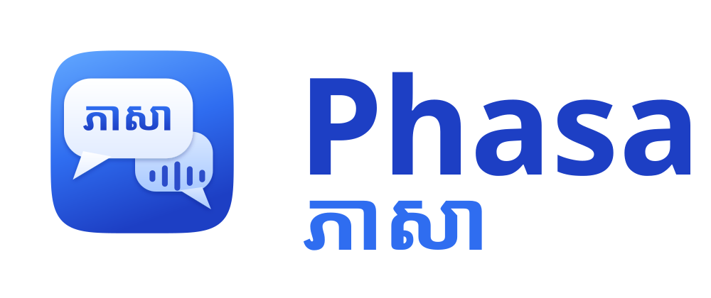

<p align="center"></p>

# Phasa

Real-time speech translation for live conversation and video calls. A Tauri v2 app with a Rust engine running inside the backend: capture, voice-activity detection, Whisper speech-to-text (candle), translation (local Marian or an OpenAI-compatible cloud API), and a light subtitle window that shows the translation with the original text below it and a speaker label.

Status: first draft. The Rust side has not been compiled or run yet; the interface builds and was checked in a browser with a mock backend.

## Prerequisites

All platforms: Rust 1.90 or newer, [Bun](https://bun.sh), and the [Tauri v2 prerequisites](https://v2.tauri.app/start/prerequisites/).

macOS: Xcode command line tools. Metal is enabled automatically.

Windows: MSVC build tools and WebView2.

Linux: `webkit2gtk-4.1`, `libayatana-appindicator`, `libasound2-dev`, `libssl-dev`, `build-essential`.

NVIDIA GPU (optional): the CUDA toolkit, then build with the `cuda` feature.

Python 3.9 or newer with its shared library and headers (for example `python3-dev` on Linux, python.org or Homebrew on macOS and Windows). The app embeds Python through PyO3, so it is needed to build, and the same Python (same minor version) must exist on the machine that runs the app. The Python packages themselves are installed later from inside the app.

## Run

```
bun install
bun tauri icon public/app-icon.svg
bun tauri dev
```

With CUDA:

```
bun tauri dev -- --features cuda
```

## First use

1. Open Models, pick Speech to text, download a Whisper model (for example `openai/whisper-tiny`), then press Use.
2. For offline translation, open Translation and download a Marian model such as `Helsinki-NLP/opus-mt-fr-en`. Or choose the cloud backend in Settings.
3. Open Settings to pick the compute device and audio sources.
4. Go to Live, choose the languages, press Start.

## Subtitle window

Press Subtitles on the Live page. Drag it from anywhere on its surface, on any screen. Use the corner grip to resize, the arrow buttons to dock it to the top or bottom of the screen it is on, and the text buttons to change the size. It remembers its position (and falls back to the bottom of the current screen if that monitor is gone) and follows you across desktops and spaces. Lock makes the mouse pass through it, which is handy over a video call; unlock it from the Live page.

Opacity, text size, number of lines, original text and speaker labels are in Settings under Subtitle window.

## Exporting

Export on the Live page saves the finished lines as SubRip (.srt), WebVTT (.vtt), a readable script (.txt), Markdown, or JSON, with the translation, the original, or both. Click a speaker name to rename it ("Speaker A" to "Marie"); the new name shows in the subtitles and in exports.

## Languages

Speech recognition covers every language Whisper supports (about 100, Khmer included), and the source can be set to detect the language of each phrase automatically. Automatic detection needs a multilingual Whisper model and the cloud translation backend. The cloud backend translates between any pair. The local backend needs a Marian model for the exact pair; the Models page has a button that searches for it. Many non-English pairs lack a `tokenizer.json` and are marked unsupported; use the cloud backend for those.

## Audio sources

The microphone is labelled "You". System audio is the other side of a call and is labelled "Remote", or "Speaker A", "Speaker B" and so on when speaker separation is on. Separation is a light spectral comparison, not a trained diarization model, so treat it as approximate.

macOS: allow Microphone access when asked. Capturing system audio through the output device may need a loopback driver such as BlackHole.

Windows: system audio uses WASAPI loopback on the default output device.

Linux: pick a "monitor" source (PulseAudio or PipeWire) under System audio in Settings.

## Echo, noise and voices

- **Echo.** With both the microphone and system audio on, the microphone also hears your speakers, which used to show every remote sentence twice (once as the speaker, once as "You"). Settings, Audio, "Remove echo from the microphone" silences the microphone while it is only picking up the speakers, and drops a "You" line that repeats a recent remote line. It is not needed with headphones. A line removed after its live preview appeared simply disappears.
- **Made-up text.** Lines that are empty, loop on one phrase, are impossibly dense for their length, or are stock phrases speech models invent on noise ("thanks for watching") are dropped before translation.
- **Voices.** With a speaker model chosen (Models, Speakers: `microsoft/wavlm-base-plus-sv`), Phasa can recognise people by voice. Click an unknown speaker (dashed outline) in a live meeting, type a name and press the fingerprint button: the voice is saved, earlier lines are renamed, and that person is named automatically in every later meeting. You can also record yourself under Settings, Speakers, Known voices (translator stopped). Voices are stored on this computer in `voices.json` in the app data folder, as numbers (an embedding), never as audio, and are only comparable to the speaker model that made them. Without a speaker model the app can only guess who is who.

## Models and the Python runtime

Models come from Hugging Face (public repositories only). The Models page marks each one as Built-in (Whisper and Marian, run in Rust with candle) or Python (almost every other Transformers model: NLLB, M2M100, other speech models, voices, speaker models). Python models run in an embedded interpreter (PyO3) inside the app process, using a private virtual environment in the app data folder. Set it up once under Storage: pick Automatic, CPU only or CUDA.

Recommendations on the Models page show approximate download sizes. Translation can also go through English with two models (language to English, then English to the target).

## Storage and cleanup

Everything lives in one app data folder, and Storage shows what uses space.

Each model is one folder. Files download to `.part` names, are size-checked, and only then renamed. A failed or cancelled download deletes the whole model folder, and anything left by a crash is swept at the next start. Deleting a model removes its folder, and clears it from Settings. The runtime is one folder too (virtual environment, packages and caches; pip runs with `--no-cache-dir` and Hugging Face loads are offline). A failed setup deletes what it created, and removing the runtime deletes all of it (on Windows, if a library is locked, deletion is queued for the next start). Saved conversations are single JSON files, removable one by one or all at once.

## Other features

Speed readout (seconds of work per second of audio) with advice when subtitles fall behind. Input level meters and a level test. First-run setup wizard. Neural voice detection (Silero) when the runtime is installed. Speaker separation by voice with a speaker model. Optional spoken translation of what remote people say, with the app muting its own input while it speaks. History (saved when you stop, searchable, exportable). Glossary. Subtitle style presets. Compact always-on-top window. Menu-bar or tray icon, and global shortcuts: Cmd+Shift or Ctrl+Shift with Space (start or stop), S (subtitles), L (lock subtitles).

Not included: automatic updates, which need a signing key and an update server of your own.

## Releases

`.github/workflows/ci.yml` type-checks the interface and runs `cargo check` and the unit tests on Linux, macOS and Windows for every pull request. Pushing a tag such as `v0.1.0` runs `.github/workflows/release.yml`, which builds installers for macOS (Apple silicon and Intel), Linux and Windows and attaches them to a draft GitHub release. The builds are not code-signed yet, and the machine that runs them still needs Python 3 with its shared library (see Prerequisites).

## Layout

```
src/                  React interface (Live, History, Models, Storage, Settings, subtitle overlay)
src-tauri/src/audio   capture, devices, resampling
src-tauri/src/engine  VAD segmenter and the live loop
src-tauri/src/stt     Whisper on candle
src-tauri/src/translate  Marian, cloud, passthrough
src-tauri/src/diarize speaker labels
src-tauri/src/models  Hugging Face search and download
src-tauri/src/runtime embedded Python (PyO3), setup and removal, worker.py
src-tauri/src/sessions saved conversations
```
